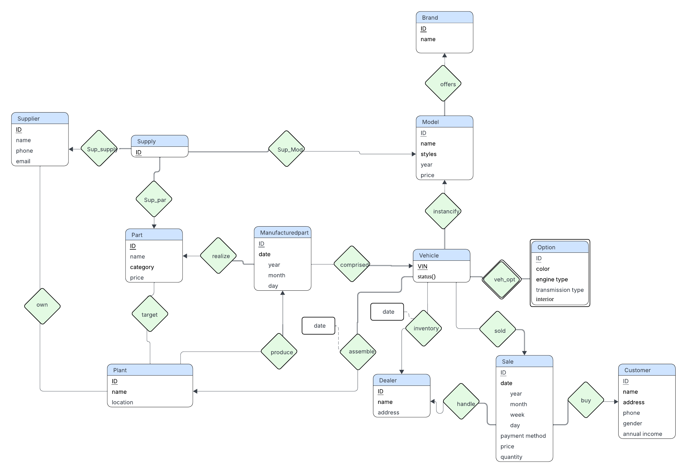

# CSE4110 Database System

서강대학교 데이터베이스시스템 수업에서 진행한 자동차 제조·판매 데이터베이스 프로젝트입니다. 과제 1에서는 자동차가 생산되고 판매되는 과정의 데이터를 ERD로 설계했습니다. 과제 2에서는 이 설계를 MySQL에 구현하고 C++ 콘솔 프로그램에서 조회할 수 있도록 연결했습니다.

## 과제 1 · ERD 설계

공급업체, 부품, 생산 공장, 차량, 딜러, 고객의 관계를 모델링했습니다. 차량 식별번호(VIN)를 기준으로 차량에 장착된 부품과 재고·판매 기록을 연결했습니다.



## 과제 2 · MySQL과 C++ 연동

ERD를 16개 테이블의 관계형 스키마로 옮겼습니다. 차량과 판매 기록이 서로 참조하는 외래 키는 두 테이블을 만든 뒤 연결했습니다. C++에서는 MySQL C API로 접속하고, 사용자 입력을 Prepared Statement의 매개변수로 전달합니다.

[논리 스키마](project2/docs/logical_schema.png) · [물리 스키마](project2/docs/physical_schema.png) · [SQL 스키마](project2/database/schema.sql) · [샘플 데이터](project2/database/sample_data.sql) · [C++ 소스](project2/src/main.cpp)

| 메뉴 | 조회 기능 |
| --- | --- |
| 1 | 판매 추이 |
| 2 | 결함 부품 추적 |
| 3 | 매출액 기준 상위 브랜드 |
| 4 | 판매량 기준 상위 브랜드 |
| 5 | 계절별 판매 패턴 |
| 6 | 딜러별 재고 효율 |
| 7 | 공급업체별 공급 범위 |

### 실행 방법

MySQL 8.0과 C++17 컴파일러가 필요합니다. MySQL Workbench에서 [스키마](project2/database/schema.sql), [샘플 데이터](project2/database/sample_data.sql) 순서로 실행하면 `cse4110_vehicle_sales` 데이터베이스가 준비됩니다.

Windows PowerShell에서 저장소 루트 기준으로 실행합니다. MySQL 설치 경로가 다르면 `$mysqlHome`을 바꿉니다.

```powershell
$mysqlHome = 'C:\Program Files\MySQL\MySQL Server 8.0'
g++ -std=c++17 project2/src/main.cpp "-I$mysqlHome\include" "$mysqlHome\lib\libmysql.lib" -o vehicle-sales.exe
$env:Path = "$mysqlHome\lib;$env:Path"
$env:DB_USER = Read-Host 'MySQL user'
$env:DB_PASSWORD = Read-Host 'MySQL password' -MaskInput
.\vehicle-sales.exe
```

기본 접속 주소는 `127.0.0.1:3306`입니다. 호스트를 바꾸려면 `DB_HOST`를 설정합니다. 콘솔에서 `1`~`7`로 조회하고 `0`으로 종료합니다.
